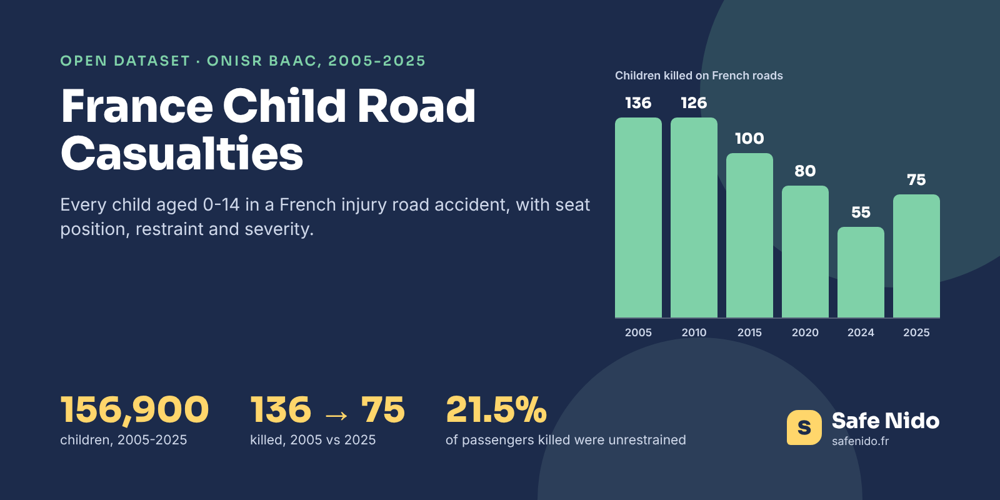

# France Child Road Casualties 2005-2025



[](https://doi.org/10.5281/zenodo.24154143) [](https://www.kaggle.com/datasets/safenido/france-child-road-casualties-2005-2025) [](https://huggingface.co/datasets/safenido/france-child-road-casualties) [](https://creativecommons.org/licenses/by/4.0/) [](https://www.safenido.fr/)

**English first, version française plus bas.**

Between 2005 and 2025, **156,900 children aged 0 to 14** were involved in an injury road accident recorded by the French police and gendarmerie. Half of them were car passengers. This dataset puts every one of those children on one row, with the year, the department, the vehicle, where the child sat, whether a child seat or a belt was used, and how badly the child was hurt.

It is extracted from the official French road accident files (BAAC) published every year by ONISR on data.gouv.fr. The 63 yearly files, in three different formats, were read one by one and joined on the accident and vehicle number, so the child rows are ready to use without rebuilding the join yourself.

### The Headline Numbers

|  |  |
|---|---|
| Children aged 0-14 involved, 2005-2025 | 156,900 |
| Of whom car passengers | 78,914 (50%) |
| Children killed in 2005 | 136 |
| Children killed in 2024, the lowest year | 55 |
| Children killed in 2025 | 75 |
| Share of children killed who were passengers, 2005-2025 | 63% |
| Unrestrained, among child car passengers involved, 2019-2025 | 4.3% |
| Unrestrained, among child car passengers killed, 2019-2025 | 21.5% |

The figures that stand out are about restraint. Since 2019, the year the police form started recording only what was actually used, where the restraint is known, unrestrained children are **4.3% of the child car passengers involved in an accident but 21.5% of those killed**, five times their share. Among children aged 0 to 9, 49 in 1,000 unrestrained passengers involved in a crash died, against 6 to 13 in 1,000 for those held by a seat belt or a child seat.

That last comparison is not a ranking of belts against child seats. Child seats carry younger and more fragile children, and the police record what they see after the crash, so the two groups are not alike. The gap with unrestrained children, on the other hand, is large, and it shows in six of the seven years since 2019 (2024, with few deaths, is the exception).

### Files

| file | content |
|---|---|
| `data/children_in_road_accidents_france_2005_2025.csv.gz` | 156,900 rows (gzip CSV, 19.9 MB once unpacked), one per child aged 0-14 involved in an injury accident |
| `data/child_car_passengers_by_year_restraint_severity.csv` | Children in cars by year, age group, restraint and severity |
| `data/children_by_year_mode_severity.csv` | All children by year, road user type, vehicle and severity |
| `data/yearly_totals_france_2005_2025.csv` | All road users per year (killed, hospitalised, slightly injured) and children killed |
| `images/cover.png` | Cover image, 1600 × 800 |

### Columns

**children_in_road_accidents_france_2005_2025.csv.gz**

| column | description |
|---|---|
| `year` | Year of the accident |
| `month` | Month, 1-12 |
| `department` | French department code (2A and 2B for Corsica, 971 and above overseas) |
| `urban_area` | built_up_area or outside_built_up_area |
| `light` | Light conditions |
| `accident_id` | BAAC accident number (Num_Acc) |
| `vehicle_ref` | Vehicle letter within the accident |
| `vehicle_type` | car, van, bus_or_coach, truck, bicycle, powered_two_or_three_wheeler... |
| `road_user` | driver, passenger or pedestrian |
| `seat_position` | front, rear, other_row, not_applicable for pedestrians, unknown |
| `restraint` | child_restraint, seat_belt, helmet, none, equipment_not_used (2005-2018 only), other, unknown |
| `severity` | unhurt, slightly_injured, hospitalised, killed (died within 30 days) |
| `sex` | male or female |
| `age` | Age in years, accident year minus birth year |
| `age_group` | 0-1, 2-3, 4-6, 7-9, 10-14 |
| `trip_purpose` | home_school, leisure, shopping... |

### Load It

```python
import pandas as pd

base = "https://raw.githubusercontent.com/safenido/france-child-road-casualties/main"
df = pd.read_csv(f"{base}/data/children_in_road_accidents_france_2005_2025.csv.gz", dtype={"department": str})
cars = df[(df.vehicle_type == "car") & (df.road_user == "passenger")]
cars.groupby(["year", "restraint"]).size().unstack()
```

### How It Was Built

The 21 yearly sets of three files (caractéristiques, véhicules, usagers) were downloaded from data.gouv.fr on 12 November 2026. Old files (2005-2018) are comma separated in Latin-1, recent ones are semicolon separated in UTF-8, and from 2022 the accident key is renamed, so each file was sniffed and read with its own settings. Each road user was joined to its vehicle on accident number and vehicle letter, age was computed as the accident year minus the birth year, and every user aged 0 to 14 was kept, unhurt children included. Codes were turned into plain English labels and nothing was imputed. The build scripts are in the Safe Nido repository.

### Checked Against The Source

Children killed per year are close to the Eurostat series for children under 15 (51 in 2024 in Eurostat, against 55 here, which also counts the overseas departments). Every year has between 5,359 (2020, lockdowns) and 10,252 (2005) children, a curve that follows the national accident totals in the same files.

### Read With Care

- **Restraint is not comparable before and after 2019.** Until 2018 the police recorded the equipment present and whether it was used, since 2019 only the equipment used. Values for 2005-2018 come from the old two digit code.
- **Hospitalised is not comparable before 2018.** The definition changed that year.
- **Seat position** is grouped as front (driver, front passenger, front middle), rear (rear left, middle, right) and other_row (minibuses, 7 seaters).
- **Age is approximate by one year**, the files give the birth year only.
- **Unknown restraint** covers 7% of child car passengers, 8.5% before 2019 and 3.7% since.

### License And Citation

**[CC BY 4.0](https://creativecommons.org/licenses/by/4.0/)**. Use it, share it and adapt it, commercially or not, and credit **Safe Nido** with a link to **[safenido.fr](https://www.safenido.fr/)**, along with the original source below.

```bibtex
@misc{safenido_france_child_road_casualties_2026,
  title  = {France Child Road Casualties 2005-2025},
  author = {{Safe Nido}},
  year   = {2026},
  doi    = {10.5281/zenodo.24154143},
  url    = {https://github.com/safenido/france-child-road-casualties},
  note   = {Dataset, version 1.0}
}
```

Source. ONISR, Bases de données annuelles des accidents corporels de la circulation routière (BAAC), data.gouv.fr, Licence Ouverte 2.0, https://www.data.gouv.fr/datasets/bases-de-donnees-annuelles-des-accidents-corporels-de-la-circulation-routiere-annees-de-2005-a-2025/

Archived on **[Zenodo](https://doi.org/10.5281/zenodo.24154143)** with a permanent DOI, 10.5281/zenodo.24154143.

Companion datasets, **[Child Road Deaths In Europe 1999-2024](https://github.com/safenido/europe-child-road-deaths)** ([Kaggle](https://www.kaggle.com/datasets/safenido/child-road-deaths-in-europe-1999-2024), [Hugging Face](https://huggingface.co/datasets/safenido/europe-child-road-deaths)), **[Child Car Seat Crash Test Statistics 2007-2026](https://github.com/safenido/child-car-seat-crash-test-statistics)** ([Kaggle](https://www.kaggle.com/datasets/safenido/child-car-seat-crash-test-statistics-2007-2026), [Hugging Face](https://huggingface.co/datasets/safenido/child-car-seat-crash-test-statistics)). All Safe Nido datasets are listed in **[Child Passenger Safety Datasets](https://github.com/safenido/child-passenger-safety-datasets)**.

Also on **[GitHub](https://github.com/safenido/france-child-road-casualties)**, **[Kaggle](https://www.kaggle.com/datasets/safenido/france-child-road-casualties-2005-2025)** with a starter notebook, and **[Hugging Face](https://huggingface.co/datasets/safenido/france-child-road-casualties)**, ready for the `datasets` library.

### On Safe Nido

The data behind these files is used on [Safe Nido](https://www.safenido.fr/), an independent French guide to child car seats built on twenty years of crash tests.

- [Why children are still badly strapped in, in figures](https://www.safenido.fr/guides/enfants-mal-attaches-chiffres/)
- [French car seat law explained](https://www.safenido.fr/reglementation-siege-auto/)
- [Until what age a car seat is needed](https://www.safenido.fr/siege-auto-jusqu-a-quel-age/)

---

## Version Française

### Les Enfants Dans Les Accidents De La Route En France, 2005-2025

156 900 enfants de 0 à 14 ans impliqués dans un accident corporel entre 2005 et 2025, un par ligne, extraits du fichier officiel BAAC de l'ONISR. Pour chacun on connaît l'année, le département, le véhicule, la place, le dispositif utilisé (siège enfant, ceinture ou rien) et la gravité.

- Depuis 2019, les enfants non attachés représentent 4,3 % des enfants passagers impliqués mais 21,5 % des enfants passagers tués.
- 136 enfants ont été tués en 2005, 55 en 2024 (le plus bas) et 75 en 2025.
- Avant 2019, la police notait l'équipement présent et son usage, depuis 2019 seulement l'équipement utilisé, donc les deux périodes ne se comparent pas directement.

Licence CC BY 4.0, en citant **Safe Nido** et un lien vers **[safenido.fr](https://www.safenido.fr/)**. Retrouvez les guides et les fiches des sièges sur [Safe Nido](https://www.safenido.fr/).
